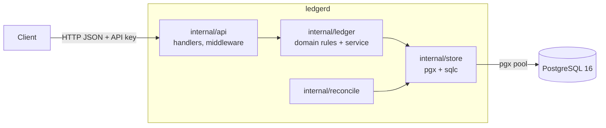
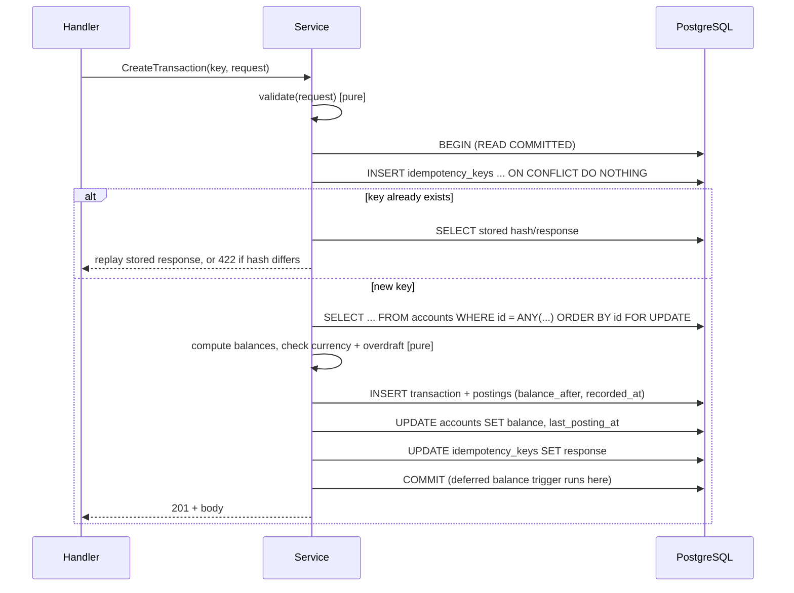

# Design Document — ledgerd (ledger-core)

## 1. Overview

`ledgerd` is a single Go service (one binary, two commands: `serve` and `migrate`) that exposes a JSON/HTTP API over PostgreSQL 16. The design goal is **correctness that can be demonstrated**: every guarantee in the requirements is enforced in two places (application logic and the database) and verified by an automated test.

### Key design decisions

| # | Decision | Rationale | Trade-off |
|---|---|---|---|
| D1 | Postings are the source of truth; `accounts.balance` is a cached running total updated in the same DB transaction | O(1) balance reads and cheap overdraft checks; reconciliation proves the cache is right | Two representations to keep consistent (mitigated by atomic write + reconciliation + tests) |
| D2 | `READ COMMITTED` isolation + explicit `SELECT … FOR UPDATE` on accounts, locked in `id` order | Deterministic, no spurious serialization failures, no deadlocks by construction | Transactions touching the same account serialize; a "hot account" is a throughput ceiling |
| D3 | Idempotency key row is inserted **inside the same DB transaction** as the ledger write | Key and effect commit or roll back together; concurrent duplicates block on the unique index and never double-apply | A retrying duplicate waits for the first request (bounded by a lock timeout) |
| D4 | Money is `NUMERIC(38,0)` in minor units (`*big.Int` in Go); amounts travel as JSON **strings**; one asset per account | Exact arithmetic with room for 18-decimal assets (1 ETH = 10¹⁸ wei overflows `BIGINT` at ~9 ETH); strings avoid precision loss in JSON clients | Slower and larger than `BIGINT`; needs a conversion layer between `pgtype.Numeric` and `*big.Int` |
| D5 | Append-only enforced by triggers **and** by DB role grants | Even a bug or a SQL console session using the app role cannot rewrite history | Slightly more setup (two DB roles) |
| D6 | Balance check re-verified by a deferred constraint trigger at commit | Database rejects an unbalanced transaction regardless of application bugs | Small per-row cost (≤100 postings per transaction) |
| D7 | Keyset (cursor) pagination on `postings.id` | Stable under concurrent inserts (R8.4), no OFFSET cost | Cursor is tied to the sort order |
| D8 | No ORM; `sqlc` generates typed code from plain SQL | Locks and queries are visible in the code — the point of the project | More SQL to write by hand |

## 2. Architecture



Layering rules:

- `internal/ledger` holds pure domain logic (types, validation, balance rules, reversal construction). It has **no** dependency on HTTP or SQL, so it can be unit- and property-tested without a database.
- `internal/store` is the only package that talks to PostgreSQL. It exposes a small interface consumed by the service, so the service can also be tested with a fake.
- `internal/service` orchestrates use cases: it validates, opens a database transaction through the store, locks accounts, applies the pure domain rules and records the result. It depends on the concrete store and is tested against a real PostgreSQL instance (a fake store would not exercise locking, constraints or isolation, which are the point of the project).
- `internal/api` translates HTTP ⇄ domain, owns authentication, idempotency-key extraction, error mapping, and logging.
- `internal/reconcile` runs read-only verification queries.

### Repository layout

```
ledgerd/
├── cmd/ledgerd/            # main: `serve` and `migrate` subcommands
├── internal/
│   ├── config/             # env parsing + validation
│   ├── ledger/             # domain types and rules (pure)
│   ├── service/            # use cases: transactions, reversals, balances
│   ├── store/              # sqlc queries, tx helper, retry, locking
│   ├── api/                # router, handlers, middleware, problem+json
│   └── reconcile/
├── migrations/             # goose SQL migrations (embedded)
├── deploy/initdb/          # creates the least-privilege app role
├── test/
│   ├── integration/        # testcontainers-based tests
│   └── concurrency/        # race, deadlock, idempotency-under-load tests
├── bench/k6/               # load script
├── docs/                   # openapi.yaml, ADRs, diagrams
├── .github/workflows/ci.yml
├── .golangci.yml
├── docker-compose.yml
├── Makefile
└── README.md
```

## 3. Data model

Amounts are whole numbers of minor units. The 10³⁰ per-posting cap leaves 10⁸ maximum-size postings of headroom before an account balance could reach the 10³⁸ limit of `NUMERIC(38,0)`, which is unreachable in practice; PostgreSQL would reject an overflow with SQLSTATE `22003` regardless.

Sign convention: a posting stores a **positive** amount and a **direction** (`DEBIT`/`CREDIT`). An account's balance changes by `+amount` when the posting direction equals the account's `normal_balance`, and by `−amount` otherwise.

```sql
CREATE TABLE accounts (
  id               uuid PRIMARY KEY DEFAULT gen_random_uuid(),
  code             text        NOT NULL UNIQUE CHECK (code ~ '^[A-Za-z0-9][A-Za-z0-9._:-]{0,63}$'),
  currency         text        NOT NULL CHECK (currency ~ '^[A-Z0-9]{2,10}$'),   -- asset code: USD, ETH, USDT...
  type             text        NOT NULL CHECK (type IN ('ASSET','LIABILITY','EQUITY','INCOME','EXPENSE')),
  normal_balance   text        NOT NULL CHECK (normal_balance IN ('DEBIT','CREDIT')),
  allow_negative   boolean     NOT NULL DEFAULT false,
  balance          numeric(38,0) NOT NULL DEFAULT 0,
  last_posting_at  timestamptz,
  created_at       timestamptz NOT NULL DEFAULT now(),
  UNIQUE (id, currency),                                    -- target of composite FK (R2.6)
  CONSTRAINT non_negative CHECK (allow_negative OR balance >= 0)   -- R4.3 (DB layer)
);

CREATE TABLE transactions (
  id           uuid PRIMARY KEY DEFAULT gen_random_uuid(),
  description  text        NOT NULL DEFAULT '' CHECK (length(description) <= 500),
  reverses_id  uuid        UNIQUE REFERENCES transactions(id),   -- UNIQUE => one reversal max (R3.3)
  created_at   timestamptz NOT NULL
);

CREATE TABLE postings (
  id             bigint GENERATED ALWAYS AS IDENTITY PRIMARY KEY,
  transaction_id uuid        NOT NULL REFERENCES transactions(id),
  account_id     uuid        NOT NULL,
  currency       text        NOT NULL,
  direction      text        NOT NULL CHECK (direction IN ('DEBIT','CREDIT')),
  amount         numeric(38,0) NOT NULL CHECK (amount > 0 AND amount <= 1000000000000000000000000000000), -- 10^30 cap
  balance_after  numeric(38,0) NOT NULL,                      -- R2.8
  recorded_at    timestamptz NOT NULL,
  FOREIGN KEY (account_id, currency) REFERENCES accounts (id, currency)   -- R2.6 at DB level
);
CREATE INDEX postings_account_id_idx   ON postings (account_id, id DESC);                    -- pagination
CREATE INDEX postings_account_time_idx ON postings (account_id, recorded_at DESC, id DESC);  -- as_of lookups
CREATE INDEX postings_transaction_idx  ON postings (transaction_id);

CREATE TABLE idempotency_keys (
  key              text        PRIMARY KEY,
  request_hash     bytea       NOT NULL,
  response_status  int         NOT NULL,
  response_body    jsonb       NOT NULL,
  transaction_id   uuid        REFERENCES transactions(id),
  created_at       timestamptz NOT NULL DEFAULT now()
);
CREATE INDEX idempotency_keys_created_idx ON idempotency_keys (created_at);
```

### Database-level safeguards

1. **Append-only (R3.1, R3.6, D5).** `BEFORE UPDATE OR DELETE` row triggers and a `BEFORE TRUNCATE` statement trigger on `transactions` and `postings` raise an exception. Separately, the application connects as role `ledgerd_app`, which is granted only `INSERT, SELECT` on those tables, `SELECT` and `UPDATE (balance, last_posting_at)` on `accounts`, and full access to `idempotency_keys`. Migrations run as the owner role `ledgerd_owner`.
2. **Balanced transactions (R2.2, D6).** A `CONSTRAINT TRIGGER … DEFERRABLE INITIALLY DEFERRED` on `postings` runs at commit and verifies `SUM(debits) = SUM(credits)` per `(transaction_id, currency)`.
3. **Non-negative balance (R4.3).** The `non_negative` CHECK constraint on `accounts`.
4. **Currency match (R2.6).** The composite foreign key `(account_id, currency)`.
5. **Single reversal (R3.3).** The unique constraint on `transactions.reverses_id`.

### Time and ordering (R7, R8.4)

`transaction.created_at` and `posting.recorded_at` are set by the application (injectable clock, truncated to microseconds) **while the account locks are held**. Because every write to an account happens under that account's row lock, postings of one account are inserted in a total order, so `postings.id` order equals commit order for that account. All postings of a transaction share a single timestamp, equal to `transactions.created_at`, computed once as the greater of the application clock and the `last_posting_at` of every locked account. Taking the maximum keeps `recorded_at` monotonic per account even if the system clock steps backwards, and sharing one timestamp guarantees that an `as_of` query can never land *between* two postings of the same transaction (which would expose an intermediate balance). For the same reason, when an account has several postings in one transaction, `as_of` uses the latest by `id`, which is the committed final balance.

- Balance at `as_of`: the `balance_after` of the latest posting of the account with `recorded_at <= as_of` (ordered by `id DESC`); `0` if none.
- Pagination cursor: the last `postings.id` returned, base64-encoded; next page is `WHERE account_id = $1 AND id < $cursor ORDER BY id DESC LIMIT $n+1`. Newly inserted rows have larger ids, so they never shift existing pages.

## 4. Core algorithms

### 4.1 Create transaction (R2, R4, R5, R6)



Details:

- **Validation (pure, no DB):** 2–100 postings, amounts parsed from strings with the strict pattern `^[1-9][0-9]{0,30}$` into `*big.Int` and limited to `(0, 10^30]`, valid asset code, per-currency debit = credit, description length. JSON numbers for money fields are rejected (decoded with `json.Decoder` into `string` fields, so a number fails to decode).
- **Lock order:** `ORDER BY id FOR UPDATE` over the distinct account ids. All writers lock in the same global order, so a lock cycle (deadlock) cannot form (R5.3).
- **Multiple postings on one account** in one transaction are applied sequentially in request order; each gets its own `balance_after` (intermediate values may be negative on a non-negative account; only the last one per account is a committed state). The overdraft check is applied to the **final** net balance per account, so a transaction cannot be rejected merely because an intermediate posting dipped below zero.
- **Overdraft (R4):** after computing the new balance for each locked account, if any `allow_negative = false` account would be `< 0`, the whole transaction is rolled back with `insufficient_funds`. The DB `CHECK` is the backstop.
- **Retry (R5.4):** SQLSTATE `40001` (serialization) and `40P01` (deadlock) are retried up to 3 times with jittered exponential backoff (10 ms base). Exhaustion returns `503` with `Retry-After`. Not expected in normal operation because of lock ordering; it is a safety net.
- **Lock wait bound:** `SET LOCAL lock_timeout = '3s'` per transaction. A timeout (`55P03`) maps to `503` retryable.

### 4.2 Idempotency (R6)

- **Key insertion first.** The first statement inserts `(key, request_hash)` with `ON CONFLICT DO NOTHING`. If a concurrent transaction holds an uncommitted row with the same key, PostgreSQL makes this statement **wait** until that transaction commits or rolls back. After it commits, the insert reports a conflict and the loser reads the stored response; if it rolled back, the loser proceeds and inserts its own row. This yields R6.5 (exactly one effect) and R6.6 (a failed attempt leaves no completed key) without a separate "in progress" state.
- **Request hash:** `sha256(method + "\n" + path + "\n" + canonical_json(body))`, where the body is decoded into the request struct and re-encoded, so key order and whitespace do not matter. A different hash for the same key returns `422 idempotency_key_reuse` (R6.4).
- **Replay:** the stored `response_status` and `response_body` are returned with the header `Idempotent-Replayed: true`.
- **Retention (R6.7):** a background goroutine deletes rows older than `LEDGERD_IDEMPOTENCY_TTL` (default `48h`, minimum enforced at `24h`) every 10 minutes.
- **Validation errors** (HTTP 4xx before any state change) are **not** stored, so the client can fix the request and reuse the key.

### 4.3 Reversal (R3)

1. In the same flow as 4.1, load the original transaction's postings.
2. Build mirror postings (opposite direction, same amounts and accounts).
3. Insert the new transaction with `reverses_id = original.id`. If the unique constraint fires, return `409 already_reversed`. If the original does not exist, `404`.
4. Overdraft rules apply as for any transaction (R3.5).

### 4.4 Reconciliation (R9)

Runs in `BEGIN ISOLATION LEVEL REPEATABLE READ READ ONLY`, so one snapshot serves all queries and concurrent writes cannot cause false mismatches (R9.5):

```sql
-- per-account check
SELECT a.id, a.balance AS stored,
       COALESCE(SUM(CASE WHEN p.direction = a.normal_balance THEN p.amount ELSE -p.amount END), 0) AS expected
FROM accounts a LEFT JOIN postings p ON p.account_id = a.id
GROUP BY a.id, a.balance
HAVING a.balance <> COALESCE(SUM(CASE WHEN p.direction = a.normal_balance THEN p.amount ELSE -p.amount END), 0);

-- global check
SELECT currency,
       SUM(amount) FILTER (WHERE direction = 'DEBIT')  AS debits,
       SUM(amount) FILTER (WHERE direction = 'CREDIT') AS credits
FROM postings GROUP BY currency;
```

It also verifies that each posting's `balance_after` chain is consistent per account (optional deep check, `?deep=true`). The report lists `accounts_checked`, `mismatches[]`, and `balanced_by_currency[]`. Reconciliation never writes (R9.4). It runs synchronously; for very large ledgers it would need to become a background job (documented limitation).

## 5. HTTP API

Base path `/v1`, JSON only, `Authorization: Bearer <api-key>`.

| Method | Path | Notes |
|---|---|---|
| POST | `/v1/accounts` | Create account |
| GET | `/v1/accounts/{id}` | Account + current balance |
| GET | `/v1/accounts/{id}/balance?as_of=` | Current or historical balance |
| GET | `/v1/accounts/{id}/postings?cursor=&limit=` | Newest first |
| POST | `/v1/transactions` | Requires `Idempotency-Key` |
| GET | `/v1/transactions/{id}` | Transaction + postings |
| POST | `/v1/transactions/{id}/reverse` | Requires `Idempotency-Key` |
| POST | `/v1/reconciliations` | Runs verification, returns report |
| GET | `/healthz`, `/readyz` | No authentication |

Example request:

```json
POST /v1/transactions
Idempotency-Key: 9b2c6f1e-...
{
  "description": "Deposit 100.00 to wallet",
  "postings": [
    { "account_id": "…bank-cash…",   "direction": "DEBIT",  "amount": "10000", "currency": "USD" },
    { "account_id": "…user-wallet…", "direction": "CREDIT", "amount": "10000", "currency": "USD" }
  ]
}
```

### Error model (RFC 9457)

```json
{ "type": "urn:ledgerd:error:insufficient_funds", "title": "Insufficient funds",
  "status": 422, "code": "insufficient_funds", "detail": "account … would be overdrawn",
  "instance": "/v1/transactions", "request_id": "…" }
```

| Code | HTTP | Cause |
|---|---|---|
| `malformed_request` | 400 | Invalid JSON, missing header |
| `unauthorized` | 401 | Missing/invalid API key |
| `not_found` | 404 | Unknown account/transaction |
| `account_code_exists`, `already_reversed` | 409 | Uniqueness conflicts |
| `method_not_allowed` | 405 | Known path, unsupported method (`Allow` header set) |
| `payload_too_large` | 413 | Body over limit (default 1 MiB) |
| `unsupported_media_type` | 415 | Request body is not `application/json` (UTF-8) |
| `validation_error`, `unbalanced_transaction`, `insufficient_funds`, `idempotency_key_reuse` | 422 | Semantic errors |
| `temporarily_unavailable` | 503 | Lock timeout / retries exhausted; sets `Retry-After` |
| `internal_error` | 500 | Unexpected; details logged, never returned (R10.4) |

## 6. Cross-cutting concerns

- **Authentication (R11):** middleware compares `sha256(provided)` with `sha256(configured)` using `subtle.ConstantTimeCompare` (equal-length digests avoid length leaks). Key comes from `LEDGERD_API_KEY`; the service refuses to start without it. Never logged.
- **Logging (R12):** `log/slog` JSON handler; middleware adds `request_id` (generated or taken from `X-Request-Id`), records method, route pattern, status, duration. Request bodies are never logged.
- **Graceful shutdown (R12.5):** `signal.NotifyContext(SIGINT, SIGTERM)` → `http.Server.Shutdown` with a 15 s deadline → close pool.
- **Server hardening:** read-header/read/write/idle timeouts set; `http.MaxBytesReader` for the body limit (R10.7).
- **Config (env):** `LEDGERD_ADDR` (`:8085`), `LEDGERD_DATABASE_URL`, `LEDGERD_MIGRATE_DATABASE_URL`, `LEDGERD_API_KEY`, `LEDGERD_IDEMPOTENCY_TTL`, `LEDGERD_MAX_BODY_BYTES`, `LEDGERD_LOG_LEVEL`.
- **Connection pool:** `pgxpool`, max conns defaulting to 20 (tuned and documented from benchmark results).

## 7. Technology and versions

| Area | Choice |
|---|---|
| Language | Go 1.27 |
| HTTP | `net/http` `ServeMux` (method + path patterns) |
| DB driver / pool | `jackc/pgx/v5` (`pgtype.Numeric` ⇄ `math/big.Int` conversion helpers in `internal/store`, covered by a round-trip property test) |
| Query codegen | `sqlc` v1.31.1 (pgx/v5 mode) |
| Migrations | `goose` v3.29.0, embedded with `embed.FS` |
| IDs | PostgreSQL `gen_random_uuid()`; `google/uuid` in Go |
| Tests | `testing`, `testcontainers-go` (postgres module), `pgregory.net/rapid`, `kin-openapi` (response validation against `openapi.yaml`) |
| Load | `grafana/k6` (Docker image) |
| Lint | `golangci-lint` v2.14.0 |
| Runtime | `postgres:16-alpine`, multi-stage Docker build to a distroless/static image |

Exact module versions are pinned in `go.mod`/`go.sum` when the module is created; container images are pinned by tag and digest in `docker-compose.yml`.

## 8. Deployment (local)

`docker compose up` starts three services: `postgres` (init script creates `ledgerd_owner` and `ledgerd_app`), `migrate` (runs `ledgerd migrate` as owner, exits), and `api` (starts after `migrate` completes successfully; connects as `ledgerd_app`). Host ports: API `8085`, PostgreSQL `15432` — both overridable, chosen to avoid the 80/3306/6379/8080 ports used by other local stacks. Both are bound to `127.0.0.1` only, and below the ephemeral range (49152+), where Windows/Hyper-V may reserve ports at random (a first attempt with 55432 failed on exactly that).

## 9. Test strategy and traceability

| Layer | What it proves | Requirements |
|---|---|---|
| Unit (`internal/ledger`) | Balance check, validation, amount limits, reversal construction, overdraft math | 2, 3.2, 4 |
| Property-based (`rapid`) | Random transaction streams keep: Σdebits = Σcredits per currency; stored balance = Σpostings; non-negative accounts never negative; reversal of any accepted transaction restores prior balances | 2, 3, 4, 5.5, 9 |
| Integration (testcontainers) | Real PostgreSQL: migrations, constraints, triggers, append-only (as `ledgerd_app`, `UPDATE`/`DELETE` fail), composite FK, pagination stability, `as_of`, reconciliation, error mapping | 1–4, 7–10 |
| Concurrency (`-race`) | 1,000 simultaneous transfers over N accounts: no lost updates, no overdrafts, no deadlocks, reconciliation clean; 50 simultaneous identical-key requests ⇒ exactly one transaction; simultaneous double reversal ⇒ one success + `409` | 3.3, 4, 5, 6 |
| Contract | Responses validated against `docs/openapi.yaml` | 10.6 |
| Benchmark (k6) | Throughput and latency percentiles, then reconciliation ⇒ 0 mismatches | 14 |
| CI | lint + `go test -race ./...` + spec check on every push/PR | 13.6, 13.7 |

## 10. Known limitations (to be stated in the README)

- A single hot account serializes writers (D2); mitigation is sharding into sub-accounts, not implemented.
- Amounts are whole minor units up to 38 digits; the service does not know an asset's display scale (decimals) — formatting is the client's responsibility. Arithmetic on `NUMERIC` is slower than on `BIGINT` (measured in the benchmark).
- API-key authentication is minimal and not production-grade (R11.4).
- Reconciliation is synchronous and scans the full ledger.
- Single PostgreSQL primary; no replication/failover design.
- Idempotency keys are global (single tenant), not scoped per client.
