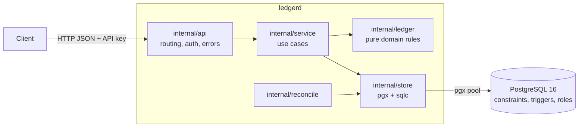
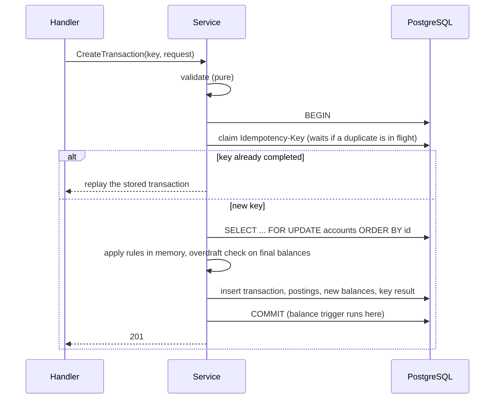

# ledgerd

[](https://github.com/CMDevRG/ledgerd/actions/workflows/ci.yml)

A small, double-entry accounting ledger with an HTTP API, built to be **correct
first and demonstrably so**: balanced transactions, exact arithmetic, idempotent
writes, overdraft protection under concurrency, and balances that can be
reconciled against the postings at any time.

It is a focused core, not a product. There is no UI, user management, currency
conversion or multi-tenancy. The point is to show, with code and tests you can run,
the properties that matter in financial systems.

> **Not production-ready as shipped.** Authentication is a single API key, meant for
> local use and demonstration. See [Limitations](#limitations).

- **Go** 1.27, **PostgreSQL** 16, no web framework and no ORM.
- Every guarantee is enforced twice, in the application and in the database, and a
  test proves the database half with plain SQL.
- Built with a written spec: [requirements](.kiro/specs/ledger-core/requirements.md) →
  [design](.kiro/specs/ledger-core/design.md) → [tasks](.kiro/specs/ledger-core/tasks.md),
  and every requirement is traced to tests in [docs/traceability.md](docs/traceability.md).

## What it guarantees

| Guarantee | Enforced in the code by | Enforced in the database by | Proven by |
|---|---|---|---|
| Every transaction balances (debits = credits, per currency) | `ledger.TransactionRequest.Validate` | deferred constraint trigger, checked at commit | unit and property tests; SQL tests that insert unbalanced rows |
| History is append-only; corrections are new, offsetting transactions | no update/delete operation exists | triggers that reject `UPDATE`/`DELETE`/`TRUNCATE`, even for the owner; the app role lacks the privileges | SQL tests as app role, owner and superuser |
| Protected accounts never go negative, even under concurrency | overdraft check on the *final* balance, under row locks | `CHECK (allow_negative OR balance >= 0)` | 1,000 simultaneous transfers; "exactly as many succeed as the balance allows" |
| A retry never repeats a money movement | `Idempotency-Key`, claimed inside the ledger transaction | unique key | 50 identical requests released together: one effect |
| Amounts are exact up to 10^30 | `*big.Int`, strict string parsing | `NUMERIC(38,0)` + `CHECK` | amounts from 2^53 to 10^30 through the API, DB, history and reconciliation |
| Stored balances equal the sum of postings | reconciliation | n/a | tampering is detected; runs clean under write load |
| A transaction is reversed at most once | check under the account locks | `UNIQUE (reverses_id)` | 12–20 simultaneous reversals: one wins |

## Quick start

Requires Docker (with Compose) and `make`. Nothing else is needed to run it.

```bash
git clone https://github.com/CMDevRG/ledgerd.git && cd ledgerd
make up        # creates .env with random secrets, builds the image, starts everything
make smoke     # an end-to-end check against the running stack
```

`make up` starts PostgreSQL, applies the migrations, then starts the API on
`http://127.0.0.1:8085` (PostgreSQL is published on `127.0.0.1:15432`, for `psql`).
Both ports are bound to the loopback interface only and can be changed in `.env`.

`make down` stops the stack and keeps the data; `docker compose down -v` deletes it.
Your API key is in `.env`.

### Run the published images

Every release publishes two images to GitHub Container Registry, tested exactly as
published (the release workflow runs the smoke test against them before pushing):

| Image | Contents |
|---|---|
| `ghcr.io/cmdevrg/ledgerd:<version>` | the service (`serve`, `migrate`, `healthcheck`), distroless, non-root |
| `ghcr.io/cmdevrg/ledgerd-postgres:<version>` | PostgreSQL 16 with the two ledgerd roles created on first start |

```bash
export LEDGERD_IMAGE=ghcr.io/cmdevrg/ledgerd:0.2.0
export LEDGERD_POSTGRES_IMAGE=ghcr.io/cmdevrg/ledgerd-postgres:0.2.0
make env       # secrets for .env
docker compose -f docker-compose.yml -f docker-compose.images.yml up --wait
```

Published versions are never overwritten. When you depend on an image, pin it by
digest (`image:tag@sha256:...`); the digests are listed in each GitHub release.
`make images` builds both locally and `make smoke-images` runs the whole stack from
them.

### Try it

```bash
set -a; . ./.env; set +a
B=http://127.0.0.1:8085; H=(-H "Authorization: Bearer $LEDGERD_API_KEY" -H "Content-Type: application/json")

# Two accounts: a bank cash account (an asset, debit-normal) and a customer wallet
# (a liability, credit-normal). Neither may go negative.
CASH=$(curl -s "${H[@]}" $B/v1/accounts -d '{"code":"bank-cash","currency":"USD","type":"ASSET","normal_balance":"DEBIT"}' | jq -r .id)
WALLET=$(curl -s "${H[@]}" $B/v1/accounts -d '{"code":"user-wallet","currency":"USD","type":"LIABILITY","normal_balance":"CREDIT"}' | jq -r .id)

# Deposit 100.00 (amounts are whole minor units, as strings).
BODY='{"description":"Deposit 100.00","postings":[
  {"account_id":"'$CASH'","direction":"DEBIT","amount":"10000","currency":"USD"},
  {"account_id":"'$WALLET'","direction":"CREDIT","amount":"10000","currency":"USD"}]}'
curl -s "${H[@]}" -H "Idempotency-Key: demo-1" $B/v1/transactions -d "$BODY"      # 201

# The same request again is a replay, not a second deposit.
curl -si "${H[@]}" -H "Idempotency-Key: demo-1" $B/v1/transactions -d "$BODY" | head -3
#   HTTP/1.1 201 Created
#   Idempotent-Replayed: true

curl -s "${H[@]}" $B/v1/accounts/$WALLET/balance            # {"balance":"10000", ...}
```

An overdraft is refused with an explanation, and nothing is recorded:

```json
{
  "type": "urn:ledgerd:error:insufficient_funds",
  "title": "Insufficient funds",
  "status": 422,
  "code": "insufficient_funds",
  "detail": "account 3b7b9e0a-c774-4e7e-8eae-515b0f0e2ce7 would be overdrawn by 1",
  "instance": "/v1/transactions",
  "request_id": "3ef2595122d5539853705270d279ec6e"
}
```

An amount sent as a JSON number is refused, because it may already have been
rounded on the client:

```json
{ "code": "validation_error", "errors": [ { "field": "postings[0].amount",
  "message": "must be a JSON string of decimal digits (for example \"10000\"), not a JSON number or other type" } ] }
```

## API

The full contract is [docs/openapi.yaml](docs/openapi.yaml) (OpenAPI 3.0). The
tests validate every request and response of the API suite against it.

| Method and path | Purpose |
|---|---|
| `GET /v1/accounts?limit=&cursor=&code_prefix=&currency=` | List accounts, newest first, keyset-paginated |
| `POST /v1/accounts` | Create an account |
| `GET /v1/accounts/{id}` | Account with its current balance |
| `GET /v1/accounts/{id}/balance?as_of=` | Current balance, or the balance at a past instant |
| `GET /v1/accounts/{id}/postings?limit=&cursor=` | History, newest first, keyset-paginated |
| `POST /v1/transactions` | Record a transaction (needs `Idempotency-Key`) |
| `GET /v1/transactions/{id}` | A transaction with its postings |
| `POST /v1/transactions/{id}/reverse` | Reverse a transaction (needs `Idempotency-Key`) |
| `POST /v1/reconciliations?deep=` | Verify the ledger against itself |
| `GET /healthz`, `GET /readyz` | Liveness, readiness (no authentication) |

Conventions: money is always a **string** of decimal digits in minor units;
identifiers are UUIDs; timestamps are RFC 3339 UTC with microseconds; errors are
[RFC 9457](https://www.rfc-editor.org/rfc/rfc9457) `application/problem+json` with a
stable `code`; authentication is `Authorization: Bearer <key>`.

## Architecture



- `internal/ledger` is pure Go with no HTTP or SQL: amounts, validation, the rules
  for applying a transaction to account balances, reversal. It is unit- and
  property-tested without a database.
- `internal/store` is the only code that talks to PostgreSQL (queries are plain SQL,
  turned into typed Go by `sqlc`; no ORM, so every lock is visible).
- `internal/service` orchestrates a use case: validate, open a transaction, lock the
  accounts in order, apply the rules, write, commit.
- `internal/api` translates HTTP to the service and back; `internal/app` wires
  everything and handles graceful shutdown.

How one transaction is recorded:



### Decisions and trade-offs

Each is written up with context, consequences and alternatives in
[docs/adr](docs/adr/README.md):

1. **Exact integers, strings on the wire** (`NUMERIC(38,0)`): floating point loses
   integers above 2^53; `BIGINT` overflows at about nine ether; JSON numbers get
   rounded by clients.
2. **`READ COMMITTED` with ordered row locks**: no lost updates and no deadlocks by
   construction. The price is that a hot account is a throughput ceiling.
3. **Idempotency inside the transaction**: the key and the money movement commit or
   roll back together, so there is no half-state to recover from.
4. **Invariants live in the database too**: a bug in the service, or whoever holds
   its credentials, cannot rewrite history or unbalance a transaction.
5. **One timestamp per transaction, never earlier than the account's last posting**:
   historical balances and pagination stay exact even if a clock steps back.
6. **Reconciliation on a consistent snapshot**: it proves the ledger is intact, while
   it is busy, without blocking anyone.

## Testing

```bash
make test-unit   # no Docker needed
make test-race   # everything, with the race detector; starts PostgreSQL in Docker
make bench       # load test (needs `make up` first)
```

`make test` and `make test-race` **fail** if Docker is unavailable, rather than
silently skipping the database tests.

| Layer | What it proves |
|---|---|
| Unit and **property-based** tests (`rapid`) | the domain rules, with random streams of transactions, amounts across 2^53 … 10^30: money is never created or destroyed, protected accounts never go negative, applying then reversing restores every balance |
| Database tests (real PostgreSQL via testcontainers) | each guarantee holds against plain SQL as the application role, the table owner and a superuser |
| Service and API tests | every endpoint and error, idempotency, reversal, historical balances, pagination stability, graceful shutdown with a request in flight |
| **Concurrency tests** (`-race`) | 1,000 simultaneous transfers across accounts with very different funds (no lost updates, nothing ever negative, clean reconciliation); "exactly as many succeed as the balance allows"; 50 identical requests; competing reversals; same key with different bodies |
| **Contract tests** | every request and response of the API suite is validated against `docs/openapi.yaml`; the route list and error codes are compared both ways; the validator is itself tested to catch drift |
| Reconciliation tests | tampering with a balance, a posting or a balance chain is detected; runs clean while writers commit |

544 test cases (205 top-level tests plus their table-driven subtests), none skipped
and none failing; each property-based test also runs 100 random cases per execution.
Statement coverage of the whole module, counting all test layers together, is
**88.8%** (91.2% excluding generated code and the test helpers).

Tests were also checked by **mutation**: deliberately breaking the code (flipping a
sign, ignoring `allow_negative`, passing amounts through `float64`, removing each
database safeguard, replacing graceful shutdown with an immediate close) and
confirming that a test fails each time. That process found and fixed gaps, and it is
why a few tests exist that otherwise look redundant.

The continuous-integration workflow (`.github/workflows/ci.yml`) runs lint, a
generated-code check, the race-detector tests against real PostgreSQL, `govulncheck`,
and a full compose run with the smoke test and a short benchmark.

## Benchmark

`make bench` load-tests the running stack with k6 and finishes with a **deep
reconciliation that fails the run if the ledger is inconsistent**. Details in
[bench/README.md](bench/README.md).

Measured at commit `7389ee7`, 20 seconds per scenario, default settings
(`LEDGERD_DB_MAX_CONNS=20`):

| Virtual users | Scenario | Transfers/s | p50 | p95 | p99 | Failed |
|---|---|---|---|---|---|---|
| 10 | spread | 210 | 41 ms | 85 ms | 145 ms | 0% |
| 10 | hot account | 69 | 147 ms | 312 ms | 458 ms | 0% |
| 20 | spread | 216 | 80 ms | 173 ms | 262 ms | 0% |
| 20 | hot account | 75 | 298 ms | 571 ms | 798 ms | 0% |
| 40 | spread | 274 | 137 ms | 215 ms | 295 ms | 0% |
| 40 | hot account | 80 | 511 ms | 709 ms | 856 ms | 0% |

*spread*: transfers between disjoint pairs of accounts. *hot account*: every
transfer credits one account. A transfer is one transaction with two postings and
the full validation, locking, idempotency and overdraft logic.

**Environment** (a modest one, and not a server): AMD Ryzen 5 3500U laptop CPU
(4 cores / 8 threads), 6.7 GiB of memory visible to WSL2, Docker Desktop 29.7.2,
PostgreSQL 16.15 in a container with default `fsync` and `synchronous_commit`, data
on a Docker named volume, k6 2.3.0 in the same Docker network. Run-to-run variation
is about ±15% (two sweeps gave 197–274 for spread).

**How to read it.**

- These are measurements on one laptop, **not** guarantees or capacity claims. Run
  `make bench` on your hardware.
- Throughput grows little beyond 10 virtual users (210 → 216 → 274 for spread, which is
  within the run-to-run variation) while latency keeps climbing: the system is
  saturated and extra load only queues. The limit is the
  database's commit latency, not the Go code. On the same machine a trivial
  `pgbench` write transaction takes 5.3 ms on one connection (about 190 per second)
  and reaches about 560 per second with 16 connections; a ledger transfer does
  more work and lands at 200–270.
- The hot-account ceiling (about a third of the spread rate) follows from design:
  writers on one account serialise for the whole transaction, so the rate is about
  `1 / (commit time + a few round trips)`. Faster storage raises it; turning
  `synchronous_commit` off would too, but could lose the latest commits in a crash,
  which a ledger must not do. The practical remedy is to split a hot account into
  sub-accounts.
- Not tried yet: pipelining the statements after the locks into one round trip
  (it would shorten the time the lock is held), larger pools, tuned PostgreSQL.

## Configuration

Environment variables (`.env` is read by Docker Compose; the binary reads the
process environment).

| Variable | Default | Meaning |
|---|---|---|
| `LEDGERD_DATABASE_URL` | required | Connection URL for the **application** role |
| `LEDGERD_MIGRATE_DATABASE_URL` | required for `migrate` | Connection URL for the **owner** role |
| `LEDGERD_API_KEY` | required | The key clients send as a Bearer token; at least 16 characters |
| `LEDGERD_ADDR` | `:8085` | Listen address |
| `LEDGERD_DB_MAX_CONNS` | `20` | Connection pool size (1–500) |
| `LEDGERD_IDEMPOTENCY_TTL` | `48h` | How long idempotency keys are kept (minimum `24h`) |
| `LEDGERD_MAX_BODY_BYTES` | `1048576` | Request body limit (1 KiB – 16 MiB) |
| `LEDGERD_LOG_LEVEL` | `info` | `debug`, `info`, `warn`, `error` |

Commands: `ledgerd serve`, `ledgerd migrate`, `ledgerd version`, `ledgerd healthcheck`.
Configuration errors are reported all at once and never print secrets (secrets are a
type that prints as `[REDACTED]` everywhere). Logs are JSON; request bodies,
headers and query strings are never logged.

## Security notes

- The API key is compared in constant time (both sides are hashed first, so even the
  length is not revealed). It is minimal on purpose: no users, roles or rotation.
  Put real authentication in front of this before exposing it.
- The container is distroless, runs as a non-root user with a read-only filesystem
  and no Linux capabilities; the default ports are bound to the loopback interface.
- The database has three roles: a bootstrap superuser, `ledgerd_owner` (schema and
  migrations only) and `ledgerd_app` (cannot alter or delete history, cannot change
  the schema).
- Unexpected errors are logged with a request id and returned as a generic
  `internal_error`; SQL and stack traces never reach the client.
- `govulncheck` reports no reachable vulnerabilities in the binary.

## Limitations

Stated plainly, because they are real:

- **A hot account serialises its writers** (see the benchmark). There is no
  sub-account sharding.
- **Amounts are whole minor units up to 38 digits** (a single posting up to 10^30).
  The service does not know an asset's decimals; formatting is the client's job.
  There is no currency conversion.
- **Authentication is a single API key.** No users, roles, scopes or rotation, and no
  TLS termination (put a proxy in front).
- **Reconciliation is synchronous** and scans the whole ledger. For a large ledger it
  should become a background job.
- **One PostgreSQL primary**; no replication or failover design. Idempotency keys
  are global (single tenant), not scoped per client.
- **Not done:** holds/reservations, an outbox to publish events, metrics endpoints,
  multi-tenancy. See the task list for ideas.
- The benchmark numbers come from one laptop under WSL2 and are indicative only.

## Development

Tools used (all pinned): Go 1.27.3, `sqlc` 1.31.1, `goose` 3.29.0 (as a library),
`golangci-lint` 2.14.0, k6 2.3.0, PostgreSQL 16.

```bash
make help            # all targets
make generate        # regenerate typed query code after editing internal/store/queries/*.sql
make check-generated # fail if the generated code is stale (CI does this)
make lint
```

Repository layout:

```
cmd/ledgerd/         the binary: serve, migrate, version, healthcheck
internal/ledger/     domain rules (pure Go)
internal/service/    use cases
internal/store/      PostgreSQL access (sqlc queries in internal/store/queries)
internal/api/        HTTP layer, internal/apicontract/ checks it against the OpenAPI file
internal/reconcile/  ledger verification
migrations/          schema, integrity triggers, grants (embedded in the binary)
deploy/initdb/       creates the two database roles
test/integration/    tests against a real PostgreSQL started by the tests
bench/               k6 load test
docs/                OpenAPI file, ADRs, traceability matrix
.kiro/specs/         requirements, design and task list
```

## How it was built

The project followed spec-driven development: [requirements](.kiro/specs/ledger-core/requirements.md)
written as testable acceptance criteria, a [design](.kiro/specs/ledger-core/design.md)
derived from them, and a [task list](.kiro/specs/ledger-core/tasks.md) of 28 ordered
steps, each ending in passing tests and a commit. Work was done with an AI coding
agent, with each design decision reviewed and approved before implementation. The
spec is part of the repository so the path from requirement to design to task to test
is visible; [docs/traceability.md](docs/traceability.md) closes that loop.

## License

MIT. See [LICENSE](LICENSE).
